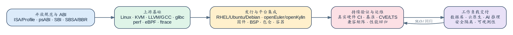
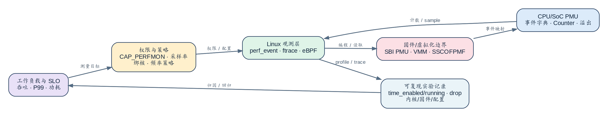
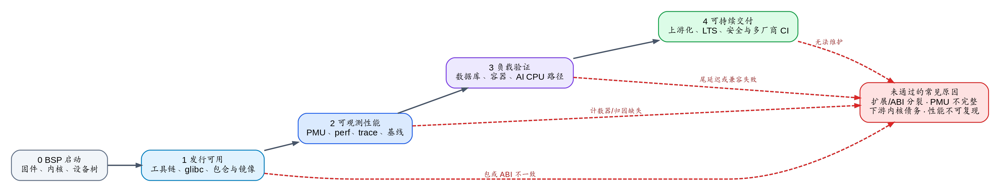

# 国内外 CPU 基础软件：操作系统、性能工程与 RISC-V 的技术发展和演进

生成说明：本文件是 document skill 的结构示例，用于展示新版固定结构的章节组织、图注写法、表格版式与来源台账格式。其中各机制小节是“结构与行文示例”，篇幅低于交付报告“技术详解”的源码级深度门槛（每节 ≥800 汉字、≥12 个可定位锚点等，见 `SKILL.md`）；复制使用时只取结构与版式，深度按门槛另行补足。内容由 AI 基于公开的一手规范、上游文档、发行版政策与项目资料整理，研究截点 2026-09-07。

| 字段 | 内容 |
|---|---|
| 文档类型 | 技术调研报告 |
| 版本 | v3.0 |
| 状态 | 结构示例（可评审） |
| 密级 | 公开资料整理 |
| 作者 | Qoder Research |
| 生成日期 | 2026-10-10 |
| 研究截点 | 2026-09-07 |
| 目标读者 | CPU、操作系统、云平台、性能工程与 AI Runtime 技术负责人 |
| 调研问题 | 国内外 CPU 基础软件在操作系统、性能优化和 RISC-V 上处于何种成熟度，国内应如何形成可交付能力？ |
| 覆盖范围 | Linux/发行版、平台规范、虚拟化与云原生、PMU/性能工具、RISC-V/RVV、AI CPU Runtime |
| 排除范围 | 不比较未公开硬件性能；不以单次厂商跑分评估 CPU；不对商业支持 SLA 作超出公开政策的推断 |

## 摘要

- 全球 CPU 基础软件的竞争单位已不是“内核是否支持某 ISA”，而是“规范—上游—发行工程—真实硬件 CI—生命周期”的交付闭环。Linux 明确拒绝冻结内核内部 ABI，Arm 以 SBSA/BBR 约束服务器平台，RHEL 以认证与支持政策兑现产品责任。[S01] [S04] [S07]
- 国内平台已具备发行集成、兼容性门户、SDK 和特定板卡优化能力；但“镜像可启动”不能替代 CPU×固件×内核×发行版 SP×驱动×工作负载的验证矩阵。openEuler、OpenAnolis、openKylin 的公开资料分别证明了集成或社区机制，而非所有硬件场景的统一认证。[S12] [S15] [S17]
- 性能优化应从单次跑分改为可追溯的观测闭环：权限策略、PMU 事件、固件/VMM、采样开销和 SLO 必须共同记录。特别在 RISC-V，SBI PMU 与 Linux 驱动的存在不保证某 SoC 的事件精度或虚拟机可比性。[S19] [S26] [S28]
- RISC-V 已拥有 RVA23、psABI、SBI、Linux 向量接口和 LLVM/GCC RVV 的关键上游基线；发行版支持、通用数值库、AI 框架原生 CI 与多硬件性能回归仍处于不均衡成熟阶段。国内应以标准 RVV 和上游接口作为主路径，把私有扩展封装为可回退优化。[S24] [S25] [S29] [S34] [S39]

## 背景与现状

本报告把“CPU 基础软件”拆分为五个层次：规范与 ABI、上游操作系统和工具链、发行版与云原生集成、真实硬件验证、工作负载交付。全文按四个可检验的问题组织：二进制与启动接口能否跨版本复用；性能能否在权限受控下观测并复现；发行版是否给出明确的升级、修复与认证边界；RISC-V/RVV 是否已从“能编译”走到 AI 服务“可部署、可回退、可验收”。

资料优先取规范、主线内核/编译器代码、正式发行版政策与认证文档；厂商发布和公开 issue 只用于描述特定实现或未完成路径。本文把“支持”拆成上游接口、发行集成、BSP 与应用性能四层，避免用低层现状推断高层成熟度；不把 RHEL/Ubuntu 的商业支持与社区发行版等同，也不把 RISC-V Profile、单板镜像或 FPGA 演示当作生产验收。

图 1：CPU 基础软件从规范到工作负载的交付闭环。来源：Linux UAPI 原则、Arm SystemReady、Kubernetes 资源治理与 openEuler 兼容资料的综合整理 [S01] [S07] [S10] [S12]；数据口径：按各项目 2026-09 官方文档整理。

见图 1，读图先看最底层的规范与固件约束（如 UEFI、Device Tree、SBSA），它们决定上层发行版和容器能复用什么；顶层的工作负载 SLO 反向要求性能观测与 CI 验证闭合。中间的发行工程与真实硬件 CI 是当前各平台差距最集中的一段。

### 操作系统、发行版与平台接口

Linux 的长期价值不在于承诺冻结内核内部模块 ABI，而在于维持用户态接口、工具链、设备模型和社区治理的可演进边界。外部驱动或专有内核模块若依赖内部符号，就必须把内核版本、配置和维护责任视为平台接口要求的一部分；这正是发行版认证和长生命周期的必要性，而不是“上游内核版本越新越好”的简单问题。[S01] [S02]

RHEL、Ubuntu 和 Debian 把同一个 Linux 基线包装为不同的运维模式：RHEL 明确支持与认证流程，Ubuntu 给出 LTS/Pro 生命周期，Debian 以稳定版和社区 LTS 提供较长维护。它们不应横向等价比较，但共同说明用户采购或部署的是内核、驱动、漏洞勘误、镜像、升级路径与支持责任的组合。硬件认证必须绑定发行版版本、架构、驱动和测试清单，不能由“兼容某个 Linux”替代。[S03] [S04] [S05] [S06]

Arm 服务器的软件可移植性借助 SBSA、BBR、SystemReady 等平台规范前移：启动、硬件发现与基础服务先被约束，通用操作系统才更可能复用。x86 的成熟度更多体现在长期 PMU 工具、虚拟化和供应链验证，而不是不需要平台差异。无论 Arm 还是 x86，合规都只是进入软件栈的前置条件，外设、NUMA、IOMMU、机密计算与性能事件仍须按整机验证。[S07] [S08] [S09]

### 云原生、虚拟化与安全隔离

CPU 基础软件的目标环境已经从裸机扩展到容器和虚拟机。Kubernetes 的 `cgroup v2` 要求节点内核、`systemd` 与容器运行时形成统一层级；`RuntimeClass` 允许按 handler 选择运行时并计入调度开销。它们让 CPU、内存与隔离能力可被编排，但同样放大了节点配置不一致、runtime handler 缺失和资源核算偏差的风险。[S10] [S11]

机密计算进一步说明“CPU 特性可用”与“平台功能可交付”不同：Intel TDX 需要 CPU、固件、VMM、客体内核、I/O 和运维策略协同；Arm CCA 的 Realm 参考栈也跨越 KVM、RMI 与 RMM。对任何国内 CPU 平台，这类能力都应按固件、VMM、CRI、远程证明和升级回滚的组合矩阵验收，而不能仅依据 ISA 宣称支持安全隔离。[S08] [S09]

### 国内平台与生态现状

openEuler 的公开兼容门户、24.03 LTS 技术资料和按 SP 标记的下载/支持信息，说明其已把多架构、云原生、虚拟化与软硬件兼容作为发行工程的一部分。对 RISC-V，Pioneer 的安装资料还明确暴露 UEFI/Legacy、内核和硬件组合约束。这是比“系统可启动”更接近平台交付的做法，但仍只覆盖已列出的版本和硬件路径，不能外推为所有 SoC 的认证结论。[S12] [S13] [S14]

OpenAnolis 23 公开以 6.6 LTS、RHEL/CentOS 兼容和 SIG/Testfarm/T-One 等社区工程为线索，说明国内发行版正在把内核基线、兼容目标和自动化测试结合起来。兼容目标不是二进制成功率的保证，尤其当应用依赖内核模块、特定 glibc 行为、内核配置或加密组件时，仍必须以实际工作负载验证。对企业来说，关键不是名称相似，而是谁对勘误、内核变更和回归结果负责。[S15] [S16]

openKylin 的多架构、容器镜像和 SIG 资料，以及针对 SpacemiT K3 的 ONNX Runtime、vLLM、XNNPACK RVV 优化，表明国内社区已经把发行集成延伸到本地 CPU 和 AI Runtime。该案例的价值是验证技术路线，不用于建立跨 CPU 的性能排名：公开公告没有附上模型、量化、输入形状、温度、固件、线程和 P99 的完整复现实验材料。因而应把它归入平台专用优化，而不是通用产品能力。[S17] [S18] [S40]

RuyiSDK 把操作系统、工具链和 IDE 等资源组织给 RISC-V 开发板；玄铁 Linux/OpenSBI 提交说明厂商 BSP 仍是硬件使能的现实路径。BSP 的商业与工程价值毋庸置疑，但若补丁未上游、扩展未标准化或缺少多版本回归，它会把升级、CVE 和工具链成本留在本地。国内项目应把“厂商分支是否有替代路径”作为选型指标，而不是默认把它当作长期兼容层。[S21] [S22] [S23] [S38]

国内外的主要差异不在于是否拥有 Linux、编译器或容器，而在于闭环的可审计程度。国际发行工程普遍把生命周期、认证规则、平台规范和升级责任公开化；国内项目的优势是更贴近本地芯片、板卡和行业负载，真正的机会是把这种贴近性转化为版本化验证，而不是累积难以迁移的私有补丁。一个可检验的判断是：如果某 CPU 平台在两个固件版本、两个内核/发行版组合和两个真实工作负载上无法重复得到一致的启动、容器、性能与升级结果，那么它的生态成熟度就缺少依据。这不是苛刻定义，而是避免把演示路径与运营能力混淆的最小门槛。[S04] [S12] [S14] [S16]

具体机会集中在四处：建立跨 CPU 的开放硬件 CI，把启动、网络、存储、容器、JIT、PMU 和 AI 推理作为同一测试资产；对发行版公开 firmware/kernel/toolchain/container 的兼容矩阵，压缩问题定位时间；把有价值的驱动、工具链和运行时改动按上游状态治理；用国内模型、数据合规和行业工作负载建立可复现实验，而不是借用不可比较的单一峰值。上述工作既能减少 BSP 债务，也能为国产软硬件协同形成持续的数据资产。[S12] [S16] [S17] [S38]

表 1 汇总各能力域的全球基线与国内进展，用于逐项比较平台成熟度，而不是给出单一排名。

| 能力域 | 全球公开基线 | 国内公开进展 | 当前差距/风险 | 推荐验收工件 |
|---|---|---|---|---|
| 内核接口与 ABI | Linux UAPI、发行生命周期与认证流程 | 多发行版提供多架构集成 | BSP 依赖内核内部接口、版本责任不清 | kernel config、kABI/驱动清单、升级回归 |
| 服务器平台接口 | SBSA/BBR、SystemReady | 目标硬件与发行版组合持续扩展 | 启动/固件/外设差异留在私有分支 | UEFI/DT、固件、外设和启动矩阵 |
| 云原生与虚拟化 | cgroup v2、RuntimeClass、TDX/CCA | 容器和虚拟化集成可见 | VMM、CRI、证明和性能隔离材料不足 | 节点配置、CRI handler、隔离和升级测试 |
| 性能可观测性 | perf、ftrace、eBPF、厂商 PMU 工具 | RISC-V PMU 与工具集成正在完善 | 事件字典、固件和 VM 语义不统一 | perf 权限、事件表、sample/drop 原始记录 |
| RISC-V/RVV 与 AI | Profile/ABI/SBI/编译器已上游 | SDK、发行和特定 RVV 优化 | 库、框架 CI、跨芯片性能与回退不足 | Profile、hwprobe、golden、P99、功耗 |

## 技术详解：从平台接口到 AI 运行时

本章逐个拆解三类关键机制：性能观测（PMU/perf/ftrace/eBPF）、RISC-V 接口栈（RVA23/psABI/SBI/RVV）与 AI CPU Runtime。每节给出调用链、接口与实现依据、失效边界、验证条件与成本权衡；机制结论均可回溯到参考来源中的版本锚点。

### PMU、perf、ftrace 与 eBPF：观测并不等于真相

调用链：`perf_event_open()` → perf 核心 → Linux SBI PMU 驱动 → SBI PMU 服务 → SoC 事件实现。

**接口与实现依据。**Linux 以 `perf_event_open`/perf 暴露性能事件，以 tracefs/ftrace 提供动态跟踪，以 eBPF hook 和 verifier 支持受约束的数据采集；权限由 `perf_event_paranoid` 和 `CAP_PERFMON` 等策略控制。在 RISC-V 上，Linux SBI PMU 驱动把事件配置、启停、读数与溢出采样下发到 SBI PMU 服务，因此接口能打开只说明调用链存在，不能证明目标 SoC 的所有事件字典、过滤和 overflow 已正确实现。见图 2。[S19] [S20] [S26] [S28]

**失效边界。**权限拒绝、计数器多路复用、`time_running` 远小于 `time_enabled`、SBI/固件事件未实现、VMM 虚拟 PMU 失真、trace buffer drop、频率漂移或绑核不一致，都会使观测结果失真。

**验证条件。**测量应固定负载、CPU governor、NUMA 与线程亲和性，同时保存 `time_enabled`/`time_running`、可用事件、采样频率、trace drop、内核/固件/VMM 版本与未插桩基线。通过条件不是“perf 能运行”，而是在重复实验中方向一致、计数器利用率合格，且应用 SLO 与至少一种独立 trace/profile 指标相互印证。[S19] [S20] [S21] [S22] [S23]

**成本与权衡。**更高采样频率、更多事件和动态探针提高归因分辨率，却增加中断、缓存扰动、存储开销与敏感信息暴露风险；限制非特权访问可降低攻击面，却降低现场诊断效率。建议把轻量常驻指标、按需 perf 采样和短时 ftrace/eBPF 诊断分层，并把原始记录作为性能回归附件。该机制的工程成本是维护事件字典、权限策略与实验自动化，收益是把“跑分快慢”变成可定位、可比较、可回归的性能数据。

图 2：从工作负载 SLO 到 CPU/SoC PMU 再回到性能回归的观测闭环。来源：Linux perf/ftrace/eBPF 文档、SBI PMU 与 Linux RISC-V PMU 驱动的接口整理 [S19] [S20] [S26] [S28]；数据口径：按各项目文档与驱动源码 2026-09 状态整理。

见图 2，读图先看左侧工作负载 SLO 如何映射为 PMU 事件，再看采样、归因与回归判定如何形成闭环；任何一环缺失，性能结论都只停留在单次测量。

### RVA23、psABI、SBI 与 Linux RVV：可移植性由多层接口约定决定

调用链：编译器 `-march` 启用 RVV → `riscv_hwprobe` 运行时检测 → 库动态分派 → 标量/RVV kernel。

**接口与实现依据。**RVA23 给出应用处理器 Profile 的 ISA 基线，psABI 定义 ELF、调用约定和对象兼容，SBI 定义固件向监督态提供的服务，Linux 为 RISC-V 向量状态和 `riscv_hwprobe` 提供内核接口，LLVM/GCC 则把 RVV 语言接口和 `-march` 选项转换为可伸缩向量代码。任何一层缺失都会改变应用的实际可移植性：Profile 不保证固件 PMU，ABI 兼容不保证向量路径，编译器能发射 RVV 也不保证发行版库或应用已按相同假设构建。[S24] [S25] [S26] [S27] [S29] [S30]

**失效边界。**应用若假定所有 RISC-V CPU 都拥有相同 VLEN、PMU 或私有扩展，会在异构 hart、模拟器、旧固件或不同板卡上产生错误或明显退化。Linux 的向量状态规则、系统调用对向量寄存器状态的影响，以及 `riscv_hwprobe` 的硬件特性查询，都要求运行时把特性检测纳入启动路径；`xtheadvector` 等私有扩展不能替代标准 RVV。

**验证条件。**验证应以标量 golden 输出校验数值，分别在目标硬件与模拟环境确认 Profile/扩展，覆盖不同输入形状、VLEN/线程配置和异常回退，并记录编译器版本、`-march`、ELF 属性及固件版本。[S25] [S27] [S29] [S30] [S39]

**成本与权衡。**fat binary、运行时分派、标量回退和多 shape kernel 可提升兼容性与性能上限，但增加包体、测试矩阵、编译时间和调试复杂度；只维护私有扩展可在短期取得单芯片收益，却抬高与上游脱节和迁移的成本。推荐以标准 RVV/ZVL 路径作为基础实现，把厂商扩展放在显式特性检测之后，用持续的正确性、吞吐、P99、功耗与升级回归来决定其去留。这个取舍直接关系国内 RISC-V 从 BSP 演示走向可维护软件生态的速度。

### AI CPU Runtime：动态分派必须穿透到服务指标

调用链：模型运行时读取硬件能力（`riscv_hwprobe`/核心数/缓存）→ 算子库分派 scalar/RVV kernel → 服务层控制并发、batch 与绑核。

**接口与实现依据。**AI Runtime 的算子层需要按 CPU 特性选择 scalar、RVV、NEON 或 AVX 等 kernel；运行时层读取硬件能力、核心数、缓存和拓扑；服务层控制并发、batch、内存池、绑核和 NUMA。OpenBLAS 的通用 RVV 1.0 路径仍处于公开议题阶段，PyTorch 的 RISC-V 支持与原生 CI 需要分辨“已实现”和“计划中”；IREE 与厂商案例展示了在指定模型或目标上可运行、可优化的路径。接口存在、开源 issue 或演示数字，都不能自动构成端到端生产承诺。[S34] [S35] [S36] [S29] [S30]

**失效边界。**若输入 shape、量化格式、上下文长度、线程数、内存容量或并发与开发假设不同，最优 kernel 可能退化；只测单 token 或预热吞吐会掩盖 TTFT、TPOT、P99、内存碎片和热约束问题。

**验证条件。**验证需用固定模型版本、量化、tokenizer、提示词和 golden 输出，分别测试冷启动、预热、单请求、并发以及不同上下文/batch，并记录 CPU/SoC、固件、内核、编译器、Runtime、绑核和频率。通过条件至少要求正确性、吞吐、TTFT、TPOT、P99、峰值内存和功耗同时达标，而不是宣称“向量指令已生成”。[S17] [S34] [S36] [S40]

**成本与权衡。**为每个 ISA、量化和 shape 建立专用 kernel 会增加维护、缓存和发布成本；通用实现降低测试压力，却可能浪费向量和内存层级能力。国内平台应先把标量/标准 RVV 的基线、回退、观测与测量工件做好，再在可复现的本地行业负载上引入专用优化，这样既保留硬件协同优势，也避免把单板案例变成难以维护的框架分叉。

## 故障定位速查

以下把三类机制中的典型症状映射到首先核对的锚点与验证手段，可用于性能与可移植性问题的第一轮定位；症状按“最后一句日志或最直接的失效指标”归并，先定位机制再进入细节。

| 症状 | 首先核对 | 验证手段 | 来源 |
|---|---|---|---|
| perf 打开失败或数字异常 | `perf_event_paranoid`/`CAP_PERFMON` 权限、`time_running` 与 `time_enabled` 比值、事件字典 | 固定负载重复实验并与未插桩基线对比 | [S19] [S28] |
| RVV 路径未生效或数值不一致 | `riscv_hwprobe` 结果、编译 `-march`、ELF 属性 | 标量 golden 对照，模拟环境复测 | [S25] [S27] |
| 同内核在不同固件/板卡行为不同 | SBI PMU 事件实现、VMM 虚拟化配置 | 记录内核/固件/VMM 版本矩阵并逐项复现 | [S26] [S28] |
| AI 服务 P99/TPOT 退化 | 输入 shape、量化、线程与绑核设置 | 固定模型与 golden，分离冷启动与并发测量 | [S34] [S40] |

若“症状”与“核对项”对不上（例如接口正常但结果漂移），应优先怀疑测量环境（频率、绑核、邻居干扰）而不是业务代码；先把观测通道本身验证干净，再讨论优化与回退。[S19] [S20]

## 总结与展望

操作系统层的主趋势是把 CPU 使能前移到平台规范和升级责任。Arm 的 SystemReady 路径、Linux UAPI 边界、RHEL 认证与长期勘误共同表明，未来两到三年能否稳定交付，更取决于固件、驱动、发行版 SP、容器基线和安全修复的组合治理，而不是某次内核移植是否完成。国内若要缩小差距，应把兼容矩阵、版本锁定、CVE 响应、驱动上游状态和真实硬件回归公开成基础产品资产。[S01] [S03] [S04] [S07] [S12]

性能工程会从专家手工 profile 演进到 SLO 驱动的持续测量。PMU 的事件语义、权限和虚拟化差异不会消失，异构 CPU 反而会放大其影响；因此“事件字典 + 实验谱系 + 回归阈值”会成为平台能力。Intel、AMD、Arm 的工具链可提供不同微架构的方法参考，却不应机械迁移。国内应先统一记录格式和校验逻辑，再逐步补足 SoC 事件映射、虚拟 PMU、低扰动采样与自动归因。[S19] [S20] [S21] [S22] [S23]

RISC-V 的 Profile、psABI、SBI、Linux 与编译器共同成熟会继续减少基础碎片化，但应用层将是推进最慢的一环。Debian、Fedora、Ubuntu 的 RISC-V 资料呈现“官方纳入、社区镜像、开发预览”并存的状态，说明发行路径仍有分层；数值库、PyTorch、IREE 和生态组织的进展同样应按“规范—代码—CI—性能—维护”逐层检验。可操作的情景是先建立标准 RVV 主线和多硬件验证，再把本地芯片优化收敛为可选择插件，而不是反向定义生态标准。[S31] [S32] [S33] [S34] [S35] [S36] [S37]

图 3：RISC-V 从 Profile/ABI/固件到内核、工具链、发行版和工作负载的成熟度依赖。来源：RVA23、psABI、SBI、Linux RVV/PMU 与 LLVM/GCC 文档的依赖关系整理 [S24] [S25] [S26] [S27] [S28] [S29] [S30]；数据口径：按各规范版本与上游文档 2026-09 状态判定层级关系。

见图 3，读图时逐层检查：每层是否已有版本、实现或测试材料支撑；任何一层缺失，整体交付成熟度就应下调。它不是性能排名，而是选择平台时必须逐项回答的依赖清单。

## 参考来源

| 来源 ID | 发布方与资料 | 用途与边界 |
|---|---|---|
| [S01] | Linux Kernel, [Stable API nonsense](https://docs.kernel.org/process/stable-api-nonsense.html) | 内核内部 API/ABI 边界，不涵盖商业支持 |
| [S02] | Linux Kernel, [Releases](https://www.kernel.org/category/releases.html) | 上游长期分支与预计结束日期快照 |
| [S03] | Red Hat, [Errata and updates policy](https://access.redhat.com/support/policy/updates/errata) | RHEL 支持政策，具体订阅另核 |
| [S04] | Red Hat, [Hardware Certification Program Policy Guide](https://docs.redhat.com/en/documentation/red_hat_hardware_certification/2026/html/red_hat_hardware_certification_program_policy_guide/assembly_introduction-red-hat-hardware-policy_hw-policy) | 认证流程与范围 |
| [S05] | Canonical, [Ubuntu release cycle](https://ubuntu.com/about/release-cycle) | Ubuntu 生命周期政策 |
| [S06] | Debian, [Releases](https://www.debian.org/releases/) | Debian stable/LTS 说明 |
| [S07] | Arm, [SystemReady Band](https://www.arm.com/architecture/system-architectures/systemready-compliance-program/systemready-band) | SBSA/BBR 互操作边界 |
| [S08] | Intel, [Trust Domain Extensions overview](https://www.intel.com/content/www/us/en/developer/tools/trust-domain-extensions/overview.html) | TDX 平台协同要求 |
| [S09] | Arm, [CCA software stack](https://developer.arm.com/documentation/den0127/latest/) | CCA/KVM/RMM 参考路径 |
| [S10] | Kubernetes, [cgroup v2](https://kubernetes.io/docs/concepts/architecture/cgroups/) | 节点资源治理前提 |
| [S11] | Kubernetes, [RuntimeClass](https://kubernetes.io/docs/concepts/containers/runtime-class/) | CRI handler 和调度开销 |
| [S12] | openEuler, [Compatibility portal](https://www.openeuler.openatom.cn/en/compatibility/) | 兼容与测试清单边界 |
| [S13] | openEuler, [24.03 LTS technical white paper](https://www.openeuler.openatom.cn/whitepaper/en/openEuler%2024.03%20LTS%20Technical%20White%20Paper.pdf) | 多架构、云原生与虚拟化资料 |
| [S14] | openEuler, [Downloads and lifecycle](https://www.openeuler.openatom.cn/en/download/) | SP/EOL 需按版本核验 |
| [S15] | OpenAnolis, [Anolis OS 23](https://openanolis.cn/anolisos/23) | 内核与兼容目标 |
| [S16] | OpenAnolis, [SIG mechanism](https://openanolis.cn/sig) | SIG、测试和集成机制 |
| [S17] | openKylin, [3.0 announcement](https://www.openkylin.top/news/4099-en.html) | 多架构和镜像公告 |
| [S18] | openKylin, [SIG list](https://www.openkylin.top/sig/siglist-en.html) | 社区治理机制 |
| [S19] | Linux Kernel, [perf security](https://docs.kernel.org/admin-guide/perf-security.html) | perf 权限与风险 |
| [S20] | Linux Kernel, [ftrace](https://docs.kernel.org/trace/ftrace.html) and [BPF](https://docs.kernel.org/bpf/) | 跟踪和 BPF 接口/开销 |
| [S21] | Intel, [VTune overview](https://www.intel.com/content/www/us/en/docs/vtune-profiler/user-guide/2024-1/overview.html) | x86 PMU 分析工具边界 |
| [S22] | AMD, [uProf User Guide](https://docs.amd.com/r/en-US/57368-uProf-user-guide/uProf-User-Guide) | AMD 工具参考，版本相关 |
| [S23] | Arm, [Streamline analysis options](https://developer.arm.com/documentation/101816/0805/Capture-a-Streamline-profile/Analysis-options) | Arm profile 分析选项 |
| [S24] | RISC-V International, [RVA23 Profiles](https://docs.riscv.org/reference/rva23/v1.0/rva23-profiles.html) | 应用处理器 Profile |
| [S25] | RISC-V International, [ELF psABI](https://riscv-non-isa.github.io/riscv-elf-psabi-doc/) | ABI 和对象兼容 |
| [S26] | RISC-V International, [SBI PMU extension](https://github.com/riscv-non-isa/riscv-sbi-doc/blob/master/src/ext-pmu.adoc) | 固件 PMU 服务边界 |
| [S27] | Linux Kernel, [RISC-V hwprobe](https://docs.kernel.org/arch/riscv/hwprobe.html) and [vector implementation](https://git.kernel.org/pub/scm/linux/kernel/git/torvalds/linux.git/tree/arch/riscv/kernel/vector.c) | 特性查询和向量状态实现 |
| [S28] | Linux Kernel, [RISC-V SBI PMU driver](https://git.kernel.org/pub/scm/linux/kernel/git/torvalds/linux.git/tree/drivers/perf/riscv_pmu_sbi.c) | Linux PMU 驱动实现 |
| [S29] | LLVM, [RISC-V Vector Extension](https://llvm.org/docs/RISCV/RISCVVectorExtension.html) | RVV 编译器实现 |
| [S30] | GCC, [RISC-V Vector Intrinsics](https://gcc.gnu.org/onlinedocs/gcc/RISC-V-Vector-Intrinsics.html) | RVV 编程接口 |
| [S31] | Debian, [RISC-V](https://wiki.debian.org/RISC-V) | 社区架构状态需按时间复核 |
| [S32] | Fedora, [RISC-V architecture](https://fedoraproject.org/wiki/Architectures/RISC-V) | 社区镜像与板卡信息 |
| [S33] | Ubuntu, [RISC-V canonical-built images](https://ubuntu.com/download/risc-v/canonical-built) | 开发/板卡支持边界 |
| [S34] | OpenBLAS, [Generic RVV 1.0 issue](https://github.com/OpenMathLib/OpenBLAS/issues/4050) | 数值库待完成路径 |
| [S35] | PyTorch, [RISC-V CI issue](https://github.com/pytorch/pytorch/issues/141550) | 框架 CI 状态，不代表不可构建 |
| [S36] | IREE, [Running models on RISC-V](https://iree.dev/community/blog/2026-07-23-running-models-on-risc-v-with-iree/) | 指定模型/目标路径 |
| [S37] | RISE, [Project overview](https://riseproject.dev/) | 生态协作方向，非实现保证 |
| [S38] | RuyiSDK, [Project site](https://ruyisdk.org/en/) | 开发资源与 SDK 定位 |
| [S39] | T-Head, [XTheadVector specification](https://github.com/T-head-Semi/thead-extension-spec/blob/master/xtheadvector.adoc) | 私有扩展，不等同标准 RVV |
| [S40] | openKylin, [RVA23/RVV optimization announcement](https://www.openkylin.top/news/4011-cn.html) | 特定硬件与配置的案例 |

## 附录 A：主要结论与依据对照

| 结论 ID | 结论 | 依据与来源 | 依据类型 | 适用边界 | 实践含义 |
|---|---|---|---|---|---|
| C-01 | Linux 内核内部 ABI 不稳定，平台必须管理版本耦合 | [S01] | 规范原文 | 不否认用户态 UAPI 的稳定目标 | BSP 补丁须记录上游状态和退出计划 |
| C-02 | 发行版 LTS 是产品政策，不等于上游分支支持期 | [S02] [S03] [S05] [S06] | 官方文档 | 具体 EOL 与订阅范围会变化 | 采购和发布锁定版本、SP 与支持责任 |
| C-03 | Arm 平台规范降低集成摩擦，不能替代整机认证 | [S07] | 官方文档 | 外设与性能仍具差异 | 以启动、固件、驱动和负载矩阵验收 |
| C-04 | 云原生资源治理依赖内核、systemd 与 CRI 同配 | [S10] [S11] | 官方文档 | 单节点可运行不代表集群一致 | 建立节点漂移检测和 RuntimeClass 测试 |

## 附录 B：检查与验收清单

| 编号 | 行动项 | 验收标准 | 验收方法 | 关联来源 |
|---|---|---|---|---|
| R-01 | 发布平台版本对照表：CPU/Profile、固件、内核、发行版、驱动、toolchain、镜像 SBOM | 两个版本组合可重复完成启动、容器与升级 | 版本清单核对 + 升级回归 | [S04] [S10] [S12] |
| R-02 | 建立真实硬件 CI：QEMU、开发板、整机三层流水线与原始日志 | 启动/网络/存储/JIT/容器/PMU/AI smoke 全绿 | 三层流水线结果比对，实机结果优先 | [S04] [S12] [S16] |
| R-03 | 规范性能观测：事件表、权限策略、实验 YAML、profile/trace 工件 | `time_running`、drop、SLO 与基线均纳入回归 | 事件不可用或多路复用失真时禁止横向对比 | [S19] [S20] [S28] |
| R-04 | 建立 RVV/AI 回退：scalar、标准 RVV、专用扩展三条路径与 golden | 正确性、吞吐、TTFT/TPOT/P99、功耗全量记录 | 私有扩展不稳定时自动退回标准 RVV/scalar | [S25] [S27] [S34] [S40] |
| R-05 | 形成下游补丁账本：补丁 ID、上游状态、维护者、替代方案 | 每个下游补丁有归属与季度复审 | 无负责人或无退出计划的补丁不得进入 LTS | [S01] [S12] [S21] |

## 附录 C：研究方法与局限

本报告采用“结论—依据—边界—验收”四步法。先按操作系统、性能工程、RISC-V/AI Runtime 列出待检验判断；再优先检索规范、主线实现、发行版政策和认证资料；对 SDK、公告、issue 和生态组织只给出与材料可靠性匹配的表述；最后为每一项工程建议指定可执行的验收物。来源台账中的 Snn 是唯一引用标识，正文每个关键结论都可回溯到台账。

复现时应固定研究截点，并记录访问日期、硬件型号、微码/固件、内核、发行版、容器镜像、编译器、运行时、系统配置、负载和原始日志。性能测试至少保留基线、预热和并发实验；RISC-V 测试同时记录 Profile、`hwprobe`、`-march`、ELF 属性和向量/标量回退；发行版测试记录升级前后版本、驱动、容器 runtime 和回滚结果。

公开政策和项目页面会更新，Linux LTS 预计结束日期、发行版订阅覆盖、RISC-V 镜像状态和板卡支持范围都必须在采购或发布时重新锁定，不应把本文研究截点外推到未来。厂商性能资料与社区公告通常缺少完整控制变量，本文只把它们作为方向或特例信息；RISC-V 的 PMU 事件、SBI 实现、VMM 虚拟化和 RVV VLEN 具有较强硬件相关性，主线代码存在并不代表任一 SoC 或云实例可用。本文未在实际目标硬件上运行数据库、容器或 AI 负载，因此给出的是验收设计而不是实测结论。

修订记录：v1.0（2026-09-07）初稿；v2.0（2026-09-07）建立国际基线与对照矩阵；v3.0（2026-10-10）按新版固定结构重排，过程性材料与术语移入附录，正文改为直述语言。

## 附录 D：术语与缩略语

| 术语/缩略语 | 含义 | 本文口径 |
|---|---|---|
| UAPI | Linux 用户态可见接口 | 不等同于内核内部 API/ABI 稳定 |
| BSP | 板级支持包 | 可使指定硬件运行，不等同于上游或发行版认证 |
| PMU | Performance Monitoring Unit | 事件、精度与权限随 CPU、固件和虚拟化配置变化 |
| SLO | Service Level Objective | 以吞吐、P99、功耗等用户侧指标衡量交付 |
| RVV | RISC-V Vector Extension | 标准向量扩展；不包含厂商私有向量扩展 |
| RVA23 | RISC-V 应用处理器 Profile | ISA 基线，不是整机兼容或发行版认证 |
| VMM | Virtual Machine Monitor | 控制虚拟机、虚拟 PMU 和隔离能力的虚拟化层 |
| TTFT/TPOT | 首 token 时间/每 token 时间 | LLM 服务端到端体验指标 |
